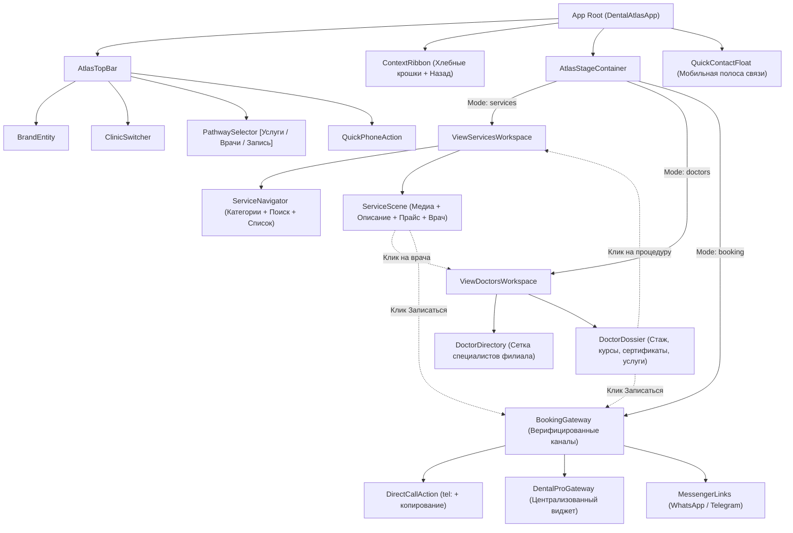

# COMPONENT_MAP.md
## Реестр и связи компонентов DENTAL ATLAS

Каждый компонент спроектирован как самостоятельная инженерная единица с явными контрактами данных, размерными ограничениями и поведением в различных состояниях.

---

### 1. Архитектурный граф зависимостей компонентов

---

### 2. Спецификация компонентов

#### 1. `ClinicSwitcher`
* **Назначение:** Переключение активного филиала клиники («Испанские кварталы» $\leftrightarrow$ «Прокшино»).
* **Место в системе:** `AtlasTopBar`, левый/центральный сектор навигации.
* **Размерные ограничения:**
  - Десктоп: высота 38 px, авто-ширина по контенту ($\le 360$ px);
  - Мобильный: высота 32 px, компактные сегменты, $100\%$ ширины доступного слота или дропдаун.
* **Связи с соседями:** Передаёт событие `branch-change` в `App Root`. Инициирует синхронное обновление `ServiceNavigator`, `ServiceScene`, `DoctorDirectory` и `BookingGateway`.
* **Состояния:**
  - `ispanskie-active` (основной филиал подсвечен);
  - `prokshino-active` (второй филиал подсвечен);
  - `focus-visible` (индикация для клавиатурной навигации).
* **Поведение при изменении контента:** При смене филиала сохраняет выбранную категорию услуги (если она есть в обоих филиалах) или переключает на первую доступную.
* **Поведение на экранах:**
  - 320–390 px: сокращённые названия («Испанские кв.» / «Прокшино»), высота тач-зоны не менее 44 px;
  - $\ge 768$ px: полные названия филиалов с адресами.
* **Критерии качества:** Смена филиала не приводит к скачку разметки (Layout Shift $\text{CLS} = 0$), мгновенный отклик $\le 30$ мс.
* **Способ исправления (Fallback):** При некорректном значении параметра `branch` в URL автоматически активируется основной филиал `ispanskie`.

---

#### 2. `PathwaySelector`
* **Назначение:** Выбор пользовательского сценария («Услуги», «Врачи», «Запись»).
* **Место в системе:** `AtlasTopBar` (десктоп) или подшапка (мобильный).
* **Размерные ограничения:** Высота 40 px; ширина таба $\ge 90$ px.
* **Связи с соседями:** Передаёт событие `pathway-change` (`services` | `doctors` | `booking`). Переключает видимый экран в `AtlasStageContainer`.
* **Состояния:** `active`, `hover`, `focus-visible`.
* **Поведение при изменении контента:** Табы фиксированы по семантике (3 базовые задачи посетителя).
* **Поведение на экранах:**
  - 320–390 px: адаптивная растяжка на 3 равных слота с крупными иконками и краткими подписями;
  - $\ge 768$ px: горизонтальный аккуратный сегментный переключатель в шапке.
* **Критерии качества:** Соответствие роли `role="tablist"` и `role="tab"`, управление стрелками `Left`/`Right`.
* **Fallback:** При неизвестном значении `view` активируется `services`.

---

#### 3. `ContextRibbon`
* **Назначение:** Отображение навигационного следа («Хлебные крошки») и кнопка быстрого возврата на шаг назад.
* **Место в системе:** Верхняя полоса рабочей области под шапкой.
* **Размерные ограничения:** Высота 32–40 px; горизонтальный скролл без полосы прокрутки при переполнении на узких экранах.
* **Связи с соседями:** Слушает изменения от `ServiceNavigator`, `DoctorDirectory` и истории браузера.
* **Состояния:**
  - `root` (показывает: *Испанские кварталы · Каталог услуг*);
  - `nested` (показывает: *Испанские кварталы → Имплантация → Установка имплантата Straumann* + кнопка `← Назад`).
* **Поведение на экранах:** На мобильных длинные названия сокращаются через многоточие (`text-overflow: ellipsis`) с сохранением кнопки возврата.

---

#### 4. `ServiceNavigator`
* **Назначение:** Интерактивный каталог категорий и процедур с поиском.
* **Место в системе:** Левая навигационная колонка в `ViewServicesWorkspace`.
* **Размерные ограничения:**
  - Десктоп: фиксированная/эластичная ширина 320–380 px, вертикальная прокрутка списка;
  - Мобильный: адаптивный блок над сценой или переключаемый аккордеон.
* **Связи с соседями:** Выбор категории обновляет процедуры; выбор процедуры транслирует данные в `ServiceScene`.
* **Состояния:** `category-selected`, `procedure-selected`, `search-filtering`, `empty-search`.
* **Поведение при изменении контента:** При поиске фильтрует список на лету. При отсутствии результатов показывает блок: *«Процедура не найдена в официальном прайсе. Позвоните администратору для уточнения»*.
* **Поведение на экранах:** На экранах $\le 640$ px категории отображаются в виде горизонтального ряда скроллируемых чипов.

---

#### 5. `ServiceScene`
* **Назначение:** Фокусная рабочая сцена выбранной процедуры (визуализация, цена, клиническая суть, профильный доктор).
* **Место в системе:** Правая часть `ViewServicesWorkspace`.
* **Размерные ограничения:**
  - Десктоп: занимает 60–65% доступной ширины сцены;
  - Мобильный: 100% ширины, вертикальный стек.
* **Связи с соседями:**
  - Связана с `ServiceNavigator` (получает объект процедуры);
  - Связана с `DoctorDossier` (отображает мини-карточку врача, выполняющего эту манипуляцию);
  - Связана с `BookingGateway` (кнопка «Записаться на процедуру» открывает шлюз с предзаполненной услугой).
* **Состояния:** `ready`, `transitioning` (плавная смена фото и текста), `price-unconfirmed` (если цена требует индивидуального расчёта).
* **Критерии качества:** Фотографии филиала кадрируются пропорционально (`object-fit: cover`), цены отображаются крупно и однозначно (например: `66 000 ₽`).

---

#### 6. `DoctorDirectory` & `DoctorDossier`
* **Назначение:** Реестр и подробное досье врачей филиала.
* **Место в системе:** `ViewDoctorsWorkspace`.
* **Размерные ограничения:** Карточка врача: ширина $\ge 280$ px; фото врача: фиксированная пропорция 4:5 с кадрированием `object-position: 50% 12%`.
* **Связи с соседями:** Содержит кликабельные теги процедур, ведущие прямо в `ServiceScene`. Кнопка записи ведёт в `BookingGateway`.
* **Состояния:** `list-view`, `detail-dossier-view`.
* **Поведение при изменении контента:** Берутся только реальные врачи из `doctors.json`. При отсутствии сертификатов блок сертификатов скрывается без пустых дыр в макете.

---

#### 7. `BookingGateway`
* **Назначение:** Честный шлюз подтверждённой записи без псевдо-форм и фиктивных свободных окон.
* **Место в системе:** Экран `ViewBookingWorkspace` + вызываемый диалог из карточек услуг и врачей.
* **Размерные ограничения:** Модальное окно: `max-width: 540px`, полноэкранное на мобильных устройствах.
* **Связи с соседями:** Получает контекст вызова (`selectedBranch`, `selectedService`, `selectedDoctor`).
* **Каналы взаимодействия:**
  1. Кнопка прямого звонка `tel:+79045199697` + кнопка «Скопировать номер» (с всплывающим подтверждением «Скопировано» на 2 сек);
  2. Кнопка перехода в WhatsApp Business;
  3. Кнопка перехода в Telegram;
  4. Кнопка перехода в онлайн-запись DentalPRO (`https://dantist-prokshino.ru/online-zapis/`) с явной подписью: *«Централизованный онлайн-модуль сети ДантистЪ»*.

---

#### 8. `QuickContactFloat`
* **Назначение:** Быстрый доступ к записи и звонку на мобильных устройствах.
* **Место в системе:** Зафиксирован в нижней части экрана на мобильных устройствах ($\le 768$ px).
* **Размерные ограничения:** Высота не более 52 px, безопасный отступ снизу (`env(safe-area-inset-bottom)`).
* **Специфическое поведение (Защита от перекрытия контента):**
  - Не закрывает важные элементы: контент страницы имеет обязательный нижний отступ `padding-bottom: 72px`;
  - Автоматически скрывается при открытии модального окна записи или клавиатуры;
  - Не содержит громоздких текстов: 2 лаконичные кнопки: «Позвонить» и «Записаться».
