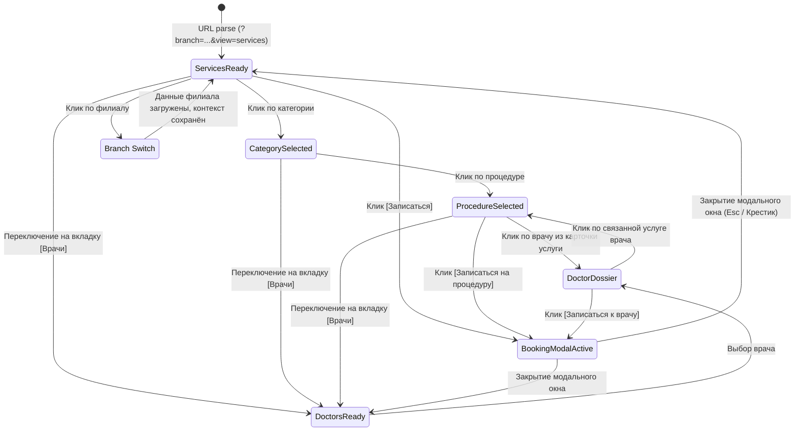

# INTERACTION_STATES.md
## Матрица состояний и переходов DENTAL ATLAS

---

### 1. Конечный автомат состояний (Finite State Machine)

Приложение управляется детерминированным состоянием `AtlasAppState`:

```typescript
interface AtlasAppState {
  branch: 'ispanskie' | 'prokshino'; // Текущий филиал (по умолчанию ispanskie)
  pathway: 'services' | 'doctors' | 'booking'; // Активный сценарий
  selectedCategory: string; // Ключ категории (напр. 'implants')
  selectedProcedureId: string; // Идентификатор процедуры (напр. 'straumann')
  selectedDoctorSlug: string | null; // Выбранный врач для досье
  bookingModalOpen: boolean; // Открыт ли диалог записи
  bookingContext?: { // Контекст передачи в шлюз записи
    serviceName?: string;
    doctorName?: string;
  };
  searchQuery: string; // Поисковая строка в навигаторе услуг
}
```



---

### 2. Таблица переходов между состояниями

| Исходное состояние | Событие (Триггер) | Конечное состояние | Действие системы | Отражение в URL |
| :--- | :--- | :--- | :--- | :--- |
| Любое | Клик по филиалу `ClinicSwitcher` | То же состояние в новом филиале | Обновление цветов, адреса, телефонов, фильтрация врачей и цен филиала | `?branch=prokshino&...` (`pushState`) |
| Любое | Клик по вкладке `[Услуги]` | `ViewServicesWorkspace` | Отображение навигатора услуг и сцены процедуры | `?view=services` |
| Любое | Клик по вкладке `[Врачи]` | `ViewDoctorsWorkspace` | Отображение реестра докторов и досье | `?view=doctors` |
| Любое | Клик по вкладке `[Запись]` | `ViewBookingWorkspace` | Открытие шлюза записи клиники | `?view=booking` |
| `services` | Клик по категории в `ServiceNavigator` | `category-active` | Фильтрация процедур, выбор 1-й процедуры, обновление `ServiceScene` | `?view=services&cat={catId}` |
| `services` | Клик по процедуре в списке | `procedure-active` | Мгновенное обновление `ServiceScene` (фото, цена, описание, профильный врач) | `?view=services&cat={catId}&id={procId}` |
| `services` | Ввод текста в поиск услуг | `search-filtering` | Фильтрация списка процедур по подстроке без смены категории | Сохраняется в памяти |
| `services` (сцена) | Клик по профильному доктору | `DoctorDossier` | Переключение в Путь B (`doctors`), фокус на выбранного доктора | `?view=doctors&id={docSlug}` |
| `doctors` (досье) | Клик по связанной процедуре врача | `procedure-active` | Переключение в Путь A (`services`), фокус на процедуре | `?view=services&cat={catId}&id={procId}` |
| Любое | Клик по кнопке «Записаться» | `BookingModalActive` | Открытие модального шлюза с сохранением контекста услуги/врача | `aria-hidden="false"`, фокус внутрь |
| `BookingModalActive` | Нажатие `Escape` или клик по оверлею | Предыдущее состояние | Закрытие модального окна, возврат фокуса на вызвавший элемент | `aria-hidden="true"` |
| Любое | Нажатие `Browser Back` (кнопка «Назад») | Состояние из `popstate` | Извлечение параметров из `location.search`, синхронизация интерфейса | Синхронизировано нативно |

---

### 3. Обработка краевых ситуаций (Edge Cases & Fallbacks)

#### 1. Несуществующий или повреждённый URL
* **Случай:** Посетитель перешёл по ссылке `/atlas/?branch=unknown&view=magic&id=999`.
* **Поведение:**
  - `branch` сбрасывается на основной филиал `ispanskie`;
  - `view` сбрасывается на `services`;
  - `cat` и `id` сбрасываются на первое валидное направление («Диагностика» / первичное обследование);
  - URL нормализуется через `history.replaceState` без замусоривания истории.

#### 2. Поиск без результатов (Empty Search State)
* **Случай:** В строке поиска введено «лазерное отбеливание космических лучей».
* **Поведение:** Список процедур скрывается. Отображается ясный сервисный блок:  
  *«Процедура с таким названием не найдена в утверждённом прейскуранте. Позвоните нашему администратору по номеру +7 (904) 519-96-97 — мы подскажем точное название и запишем вас на осмотр»*.

#### 3. Отсутствие фиксированной цены
* **Случай:** Процедура с ценой «по согласованию» или требующая предварительной диагностики (например, сложный синус-лифтинг).
* **Поведение:** Вместо вводящей в заблуждение псевдо-цены крупно выводится плашка:  
  *«Точная стоимость рассчитывается после КТ и составления плана лечения»*. Никаких цен «от 0 ₽».

#### 4. Режим пониженной динамики (`prefers-reduced-motion`)
* **Поведение:** Все CSS-переходы (opacity, transform) отключаются (`transition: none !important`). Смена фотографий и экранов происходит дискретно и мгновенно, без анимационного укачивания.
