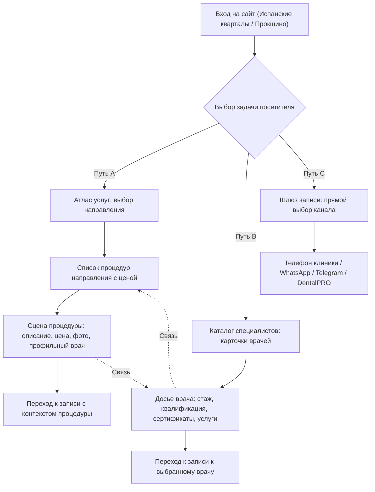

# PRODUCT_BLUEPRINT.md
## DENTAL ATLAS — Архитектура интерактивной цифровой клиники «ДантистЪ»

---

### 1. Концепция и отказ от шаблонного лендинга

Предыдущие версии (V6–DX) воспроизводили одну и ту же шаблонную модель классического рекламного лендинга:
* Фиксированный Hero-баннер с громким слоганом и кнопкой;
* Тройка маркетинговых преимуществ;
* Таблица услуг или бесконечный аккордеон;
* Ряд карточек врачей с урезанными описаниями;
* Фотогалерея и форма захвата контактов.

**DENTAL ATLAS** полностью отказывается от этой парадигмы.  
Вместо страницы бесконечной вертикальной прокрутки создаётся **единое цифровое рабочее пространство клиники** («Digital Clinic Navigation System»), где посетитель сразу получает контроль над своими задачами.

Интерфейс строится вокруг трёх естественных потребностей посетителя стоматологии:
1. **Путь A («Услуги»):** Пациент ищет решение конкретной проблемы (боль, имплантация, прикус, профгигиена). Ему нужны честные процедуры, официальные цены, визуальный контекст и квалифицированный врач, выполняющий данное вмешательство.
2. **Путь B («Врачи»):** Пациент ищет конкретного эксперта (по рекомендации, фамилии или стажу). Ему важно увидеть специализацию, подтверждённое образование, сертификаты, прикреплённый филиал и связанные процедуры.
3. **Путь C («Запись»):** Пациент готов записаться прямо сейчас. Ему не нужны лишние клики — только актуальный филиал, прямой телефон администратора в 1 клик, защищённый чат (WhatsApp/Telegram) или переход в официальный МИС DentalPRO.

Все три пути живут в рамках **единой интерактивной сцены**, сохраняют контекст и позволяют мгновенно переключаться между собой без перезагрузки страницы и без потери выбранного филиала.

---

### 2. Три пользовательских сценария (User Journeys)

#### Сценарий A: «Хочу разобраться с услугами»
1. **Точка входа:** Посетитель выбирает вкладку `[Услуги]` в навигаторе путей (или переходит по прямой ссылке `?view=services&cat=implants`).
2. **Выбор направления:** Отображаются 6 ключевых направлений клиники («Диагностика», «Лечение зубов», «Имплантация», «Протезирование», «Ортодонтия», «Профгигиена»).
3. **Фокусировка на процедуре:** Выбор направления разворачивает список подтверждённых процедур с официальной стоимостью (из SSOT).
4. **Сцена услуги (`ServiceScene`):**
   - Правая часть сцены (на десктопе) или следующий блок (на мобильном) мгновенно обновляется:
   - Отображается аутентичное фото кабинета или оборудования филиала;
   - Заголовок процедуры и клиническое назначение;
   - Точная базовая стоимость (или диапазон по официальному прейскуранту);
   - Карточка профильного врача филиала с подтверждённой специализацией;
   - Кнопка действия: «Записаться на процедуру» и «Скопировать прямую ссылку».
5. **Сохранение контекста:** При клике на врача из карточки услуги система бесшовно переключается в Путь B, открывая досье этого врача, при этом в истории браузера можно нажать «Назад» и вернуться к процедуре.

#### Сценарий B: «Хочу выбрать врача»
1. **Точка входа:** Вкладка `[Врачи]` (`?view=doctors`).
2. **Обзор специалистов филиала:** Список подтверждённых докторов с аутентичными фото, должностями и подтверждённым клиническим стажем (без округлений и выдумок).
3. **Досье врача (`DoctorDossier`):**
   - Полное имя, подтверждённый стаж (например, «25 лет» для Даниеляна А.Я.);
   - Дополнительное образование и подтверждённые курсы (с указанием года и школы);
   - Выполняемые процедуры в данном филиале (кликабельные чипы с переходом в сценарий A);
   - Прямая кнопка «Записаться к врачу» (переход в Путь C с предзаполненным именем врача в примечании).

#### Сценарий C: «Хочу сразу записаться»
1. **Точка входа:** Вкладка `[Запись]` (`?view=booking`) или плавающая кнопка быстрого доступа.
2. **Выбор подтверждённого канала:**
   - **Телефон:** `+7 (904) 519-96-97` (прямой клик `tel:` + кнопка копирования в буфер с обратной связью);
   - **WhatsApp:** `https://wa.me/message/2WBFWCZJGHQDG1` (прямой верифицированный диалог);
   - **Telegram:** `@Stomatologiya1108` (официальный аккаунт);
   - **DentalPRO (онлайн-запись):** прямая ссылка на централизованный рабочий сервис `https://dantist-prokshino.ru/online-zapis/` с пояснением: *«Централизованная система онлайн-записи сети клиник ДантистЪ»*.
3. **Защита от фейков:** Никаких псевдо-календарей со свободными ячейками на завтра в 14:00, никаких фейковых уведомлений «Ваша заявка принята роботом».

---

### 3. Правила переключения филиалов

Сеть состоит из двух клиник с чётким приоритетом:
- **Основной филиал:** «Испанские кварталы» (Москва, Коммунарка, ул. Магеллана, 5);
- **Второй филиал:** «Прокшино» (Москва, Коммунарка, Лобановский Лес, 11).

При переключении филиала через `ClinicSwitcher`:
1. **URL обновляется:** Параметр `branch=ispanskie` меняется на `branch=prokshino` без перезагрузки страницы (через `history.pushState`).
2. **Данные фильтруются строго по выбранному филиалу:**
   - Отображаются только врачи, ведущие приём в данном филиале;
   - Цены берутся исключительно для выбранного филиала;
   - Загружаются только аутентичные фотографии кабинетов и зон данного филиала;
   - Подставляются точный адрес, ориентиры метро и режим работы филиала.
3. **Состояние выбора сохраняется:** Если в Испанских кварталах была выбрана «Имплантация», при переключении на Прокшино фокус остаётся на имплантации, но цены, врачи и фотографии пересчитываются под Прокшино.

---

### 4. Два принципиально разных структурных решения

Для реализации архитектуры DENTAL ATLAS спроектированы два фундаментально различающихся решения.

#### РЕШЕНИЕ 1: «Интерактивный Атлас-Консоль» (The Clinical Canvas) — *ПРЕДПОЧТИТЕЛЬНОЕ*
* **Архитектурный принцип:**  
  Единое трехзонное рабочее пространство (Контекст-Лента $\rightarrow$ Навигационная Матрица $\rightarrow$ Динамическая Сцена), трансформирующееся в реальном времени.
* **Десктопная компоновка (1440 px):**  
  Горизонтальная шапка (Бренд + Переключатель филиалов + Вкладки путей A/B/C) $\rightarrow$ Под ней двухколоночная сбалансированная консоль:
  - Слева (40%): Навигационный реестр (категории, фильтры, список сущностей с мгновенным поиском);
  - Справа (60%): Динамический экран сущности (крупное фото, карточка параметров, цена, профильные врачи, вызов шлюза записи).
* **Мобильная компоновка (390 px):**  
  Вертикальная адаптивная трансформация:
  - Компактный хедер (Бренд + мини-свитчер филиала);
  - Переключатель 3 режимов в виде тактильных табов;
  - Сжатый выбор сущности (горизонтальная прокрутка чипов направлений);
  - Полноразмерная сцена выбранного объекта;
  - Плавающий нижний триггер быстрой связи (не перекрывающий контент).
* **Преимущества:**
  - Предельная собранность: пользователь никогда не теряется, всё управление находится в пределах одного экрана без хаотичного скролла;
  - Высокая скорость восприятия: переключение категорий и услуг происходит мгновенно (<50 мс);
  - Идеальная адаптация под мобильные устройства без дублирования блоков.
* **Недостатки:**
  - Требует строгой дисциплины в верстке динамической сцены, чтобы длинные медицинские описания не ломали высоту экрана.

#### РЕШЕНИЕ 2: «Архитектурное Досье» (Split Studio / Architectural Dossier)
* **Архитектурный принцип:**  
  Асимметричный каталог-журнал с раздельными полосами прокрутки (Split-screen) и выезжающей карточкой-досье (Drawer/Off-canvas).
* **Десктопная компоновка (1440 px):**  
  Левая половина — независимая скролл-лента карточек всех процедур и врачей с крупными типографическими индексами (01, 02, 03...);  
  Правая половина — зафиксированная витрина с фотографией клиники, переключателем филиалов и контактным шлюзом. При клике на карточку справа открывается детальное досье.
* **Мобильная компоновка (390 px):**  
  Одноколоночный список карточек. При клике открывается полноэкранный Bottom Sheet (шторка снизу) с подробностями услуги или врача.
* **Преимущества:**
  - Выглядит как дорогой редакционный архитектурный журнал;
  - Подходит для размещения объёмных текстовых материалов и сертификатов.
* **Недостатки:**
  - Вложенный независимый скролл на десктопе может конфликтовать со стандартным колесом мыши и трекпадами;
  - На мобильных устройствах шторки создают избыточную глубину навигации («закрыть шторку чтобы выбрать другую услугу»);
  - Сложнее сохранять глубокие прямые ссылки (Deep Links) в поисковых системах.

> **Решение команды:** В качестве основы прототипа принимается **Решение 1 («Интерактивный Атлас-Консоль»)** как наиболее функциональное, устойчивое и удобное для реальных сценариев записи.

---

### 5. Структура глубоких ссылок (Deep Linking Schema)

Все экраны и состояния имеют детерминированное отражение в URL параметрах:

| URL | Состояние системы |
| :--- | :--- |
| `/atlas/?branch=ispanskie` | Основной филиал «Испанские кварталы», стартовый экран |
| `/atlas/?branch=prokshino` | Второй филиал «Прокшино», стартовый экран |
| `/atlas/?branch=ispanskie&view=services&cat=implants` | Испанские кварталы, Атлас услуг, категория «Имплантация» |
| `/atlas/?branch=ispanskie&view=services&cat=implants&id=straumann` | Испанские кварталы, услуга «Имплантация Straumann», открыта детальная сцена |
| `/atlas/?branch=ispanskie&view=doctors` | Каталог врачей филиала Испанские кварталы |
| `/atlas/?branch=prokshino&view=doctors&id=danielyan` | Прокшино, досье доктора Даниеляна А.Я. |
| `/atlas/?branch=ispanskie&view=booking` | Шлюз подтверждённой записи для Испанских кварталов |

Система поддерживает нативную историю браузера: кнопка `Назад` возвращает на предыдущее состояние фильтра или выбора без перезагрузки страницы.
